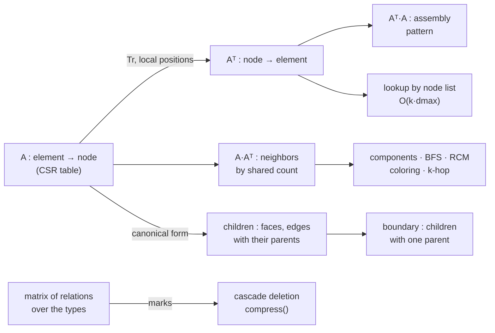
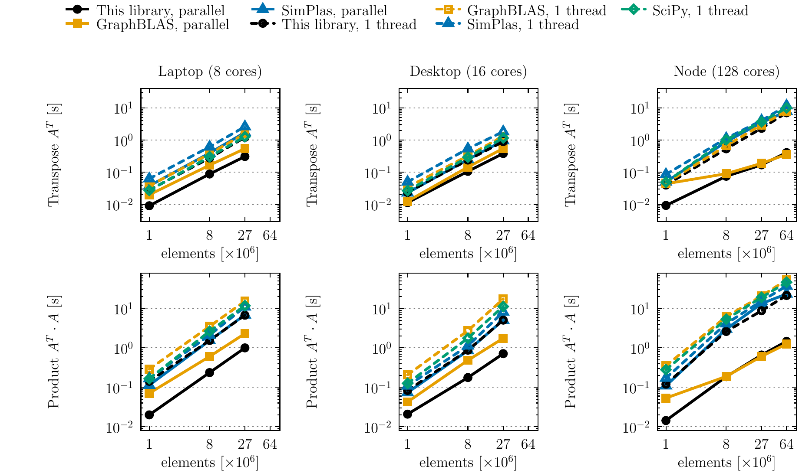
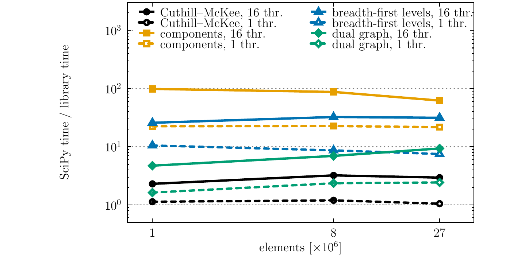
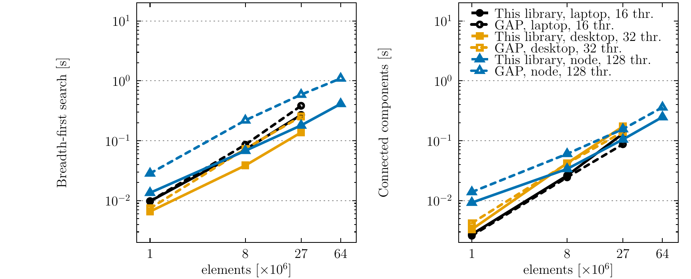

<p align="center"></p>

<h3 align="center">One table, three operations, two rules: every adjacency of a discretization, type-safe and at memory speed.</h3>

<p align="center">
<a href="https://github.com/PedroAreiasIST/many2many/actions/workflows/cmake-single-platform.yml"></a>


</p>

**many2many** is a C++20 library for the many-to-many relations of discretization software: element-node, face-node and edge-node connectivities, boundary-condition sets, element groups, and the dependencies between them. One table type in compressed row storage, three symbolic operations (transpose, composition, row-wise set algebra) and two schema-level rules (canonical node lists under a symmetry group, synthesized children that record their parents) generate every derived adjacency a finite-element or mesh code needs. The entity types are compile-time keys of a matrix of relations, so a face can never be looked up in the edge table.

The framework and this implementation are described in *A Software Library for Type-Safe Management of Many-to-Many Relations and Dependencies in Computational Mechanics* (P. Areias, T. Rabczuk, M. F. Vaz; *International Journal for Numerical Methods in Engineering*, revised version, 2026). Every number on this page is the stored output of a script in [`bench/`](bench/).

## Highlights

- **Fastest of the four codes measured.** On hexahedral meshes of 10⁶ to 6.4×10⁷ elements, on a laptop, a 16-core desktop and a 128-core node, the symbolic transpose and the symbolic product run faster than SciPy, SuiteSparse:GraphBLAS and the hand-written routines of a production solver with 16 threads at every size (1.1 to 3.5 times faster than GraphBLAS) and with one thread at every size but one. The one exception is stated below: at the node's 128 threads across eight NUMA domains, GraphBLAS is ahead by 8 to 14% on the two largest meshes.
- **Lookup by node list in 0.3 to 0.7 µs**, independent of the mesh size (the SciPy rendering of the same intersection costs 14 to 18 µs, the GraphBLAS interface 0.4 to 1.0 ms).
- **Linear scaling.** 144×10⁶ quadrilaterals assemble symbolically in 6.9 s and 64×10⁶ hexahedra in 4.6 s on 16 threads of eight cores, with empirical slopes of 1.0 to 1.2 and a Karp–Flatt serial fraction of 0.05.
- **Graph queries 2.3 to 99 times faster than SciPy's csgraph** at 16 threads (components, breadth-first levels, reverse Cuthill–McKee, dual graphs, coloring), and faster with one thread on every query. Against the GAP benchmark suite, the breadth-first search is faster than the direction-optimizing search at every thread count on the three machines, and the components are at parity with Afforest.
- **Ten million faces per second.** The 3.03×10⁶ faces of 10⁶ hexahedra are synthesized, with their parents, in 0.29 s.
- **A production mesh splitter ported with fewer than 30 library calls** reproduces its original and runs in 0.35 s against 2.0 s on the same cores.

## Contents

- [The idea](#the-idea)
- [A worked example](#a-worked-example)
- [Derived queries](#derived-queries)
- [Algorithms and implementation](#algorithms-and-implementation)
- [Costs](#costs)
- [API reference](#api-reference)
- [Benchmarks](#benchmarks)
- [Build, test, reproduce](#build-test-reproduce)
- [Repository layout](#repository-layout)
- [Application: simplex mesh splitting](#application-simplex-mesh-splitting)
- [Citation, license, acknowledgments](#citation-license-acknowledgments)

## The idea

A relation between two entity types is a connectivity table: row *e* lists the nodes of element *e*, in order. Stored in compressed row storage it is the pattern of a sparse Boolean matrix *A*, and everything a discretization code asks about adjacency is one of three symbolic operations on such tables:

| Operation | Result | What it answers |
|---|---|---|
| **Transpose** `Tr(A)`, with *local positions* | Aᵀ: node → elements, and for every incidence the position of the node inside the element and of the element inside the node's row | which elements touch a node; lookup of an element by its node list; local-to-global maps |
| **Composition** `A * B` (symbolic product) | A·Aᵀ: element neighbors with shared-node counts; Aᵀ·A: the node-to-node assembly pattern; clique destinations | neighborhoods, dual graphs, the sparsity pattern of the stiffness matrix, the slot of each element entry in it |
| **Row-wise set algebra** `A + B`, `A && B`, `A - B` | union, intersection, difference of the rows | groups, boundary-condition sets, differences between meshes |

Two schema-level rules turn tables of nodes into a mesh of typed entities:

1. **Canonical form under a symmetry group.** Each entity type declares the permutations of its node list that describe the same entity (the rotations of a tetrahedron, the dihedral group of a shared face). The canonical representative is the lexicographic minimum of the orbit, so equal entities are found by ordering, not by hashing.
2. **Synthesized children that record their parents.** Faces and edges are declared as builders on the parent's local nodes; synthesis produces them in canonical form, deduplicates them, and stores the parents of each child in one more table of the matrix. The boundary is the set of children with one parent; removing a parent decrements its children; removing a node cascades through every type that lists it.



The whole thing is a few lines of NumPy/SciPy, and the paper gives that rendering. What this library adds is the typed layer and kernels that run at the speed of the memory system.

## A worked example

The paper's running example: seven nodes, a tetrahedron, two edge elements and a wedge, with the edge (2, 4) shared by the two volumes. The types are empty structs that key the matrix of relations; the standard elements come from [`catalog.hpp`](catalog.hpp) with their rotation groups, faces and edges.

```cpp
#include "catalog.hpp"
#include "graph.hpp"
#include "zoo.hpp"

struct isanelement {}; struct node {}; struct edge {}; struct tri {}; struct quad {}; struct tet {}; struct wedge {};
using MeshTypes = typseque<isanelement, node, edge, tri, quad, tet, wedge>;

zoo<MeshTypes> g;
g.definesymmetrygroup<isanelement, isanelement>({{}});
g.definesymmetrygroup<node, node>({{}});
declare<edge, node>(g, catalog::bar2());                       // group of the edge
declare<tri, node, void, void, edge>(g, catalog::tri3());      // group, edges
declare<quad, node, void, void, edge>(g, catalog::quad4());
declare<tet, node, tri, void, edge>(g, catalog::tet4());       // group, faces, edges
declare<wedge, node, tri, quad, edge>(g, catalog::wedge6());   // group, triangular and quadrilateral faces, edges

thing t0; g.appendnodestoathing<tet, node>(t0, {4, 2, 6, 0});
thing e1; g.appendnodestoathing<edge, node>(e1, {3, 0});
thing e2; g.appendnodestoathing<edge, node>(e2, {3, 1});
thing w3; g.appendnodestoathing<wedge, node>(w3, {6, 3, 5, 1, 2, 4});
for (thing *t : {&t0, &e1, &e2, &w3}) g.uploadelement(*t);     // children synthesized at insertion ...
g.deduplicate<tri, node>();                                    // ... and merged: a shared face keeps both parents
// or, for a whole mesh at once: g.synthesize<tet, tri, node>(); g.synthesize<wedge, tri, node>(); ...

seque<int> skin = g.getboundary<tri, tet>();                   // faces with one parent
g.removenode<node>(3);                                         // marks the node ...
g.compress();                                                  // ... and everything that lists it goes, children reference-counted
```

On the untyped layer the same mesh is one `m2m` (a relation and its transpose kept in step) and the queries are plain functions:

```cpp
m2m rel;                                   // rel.nfrome: element → nodes, rel.efromn: node → elements
appendelement(rel, {4, 2, 6, 0});
appendelement(rel, {6, 3, 5, 1, 2, 4});
synchronize(rel);                          // transpose and local positions
auto who   = getelementswithnodes(rel, {2, 4});     // elements sharing the edge (2,4): both
o2m dual   = getdualgraph(rel, 3);                  // element graph, at least three shared nodes
o2m nodes  = getnodegraph(rel);                     // node graph (assembly pattern), rows ordered
seque<int> label; int ncomp = getcomponents(nodes, label);
seque<int> rcm = getrcmorder(nodes);                // reverse Cuthill–McKee numbering
```

[`bench/running_example.cpp`](bench/running_example.cpp) prints every relation of this example after insertion, deduplication and the removal of node 3; the paper's tables were cross-checked against its output.

## Derived queries

Everything a graph library offers on a mesh comes from the tables the framework already keeps ([`graph.hpp`](graph.hpp)):

| Query | Function | Algorithm |
|---|---|---|
| Dual graph with at least *s* shared nodes, with counts | `getdualgraph(rel, s, &counts)` | the composition A·Aᵀ as one counting pass, per-thread output buffers |
| Node graph (assembly pattern) | `getnodegraph(rel)` | Aᵀ·A, rows ordered |
| Neighbors of one element by shared count, *k*-hop neighborhood | `getelementssharing(rel, e, s)`, `getkhopneighborhood(rel, e, k, s)` | local intersections on the transpose rows |
| Connected components of the incidences or of any symmetric relation | `getcomponents(rel, elabel, nlabel)`, `getcomponents(graph, label)` | hooking by compare-and-swap in the manner of Afforest: two rounds over the first two neighbors, the largest component read from a sample of 1024 vertices, the rest visited only from outside it; labels independent of the thread schedule |
| Breadth-first levels | `getbfslevels(graph, v)` | level-synchronous, frontier expanded in parallel, a vertex claimed by the first thread that swaps its unset level |
| Reverse Cuthill–McKee, bandwidth | `getrcmorder(graph)`, `getbandwidth(graph, order)` | parallel pseudo-peripheral start search on the levels; sequential numbering with the rows of the queued vertices prefetched while the current neighbors are sorted by degree |
| Greedy coloring | `getcoloring(graph, color)` | first-fit in vertex order (elements of one color assemble without atomics) |
| Append keeping the transpose valid | `appendelementsynchronized(rel, nodes)` | amortized growth of both tables |

## Algorithms and implementation

**Storage.** A relation is one pooled array of node indices and one array of row offsets: 4 bytes per incidence and 4 bytes per row, the layout of every sparse-matrix code. Rows are read and written through *views* (a pointer and a length) that cost nothing to create. The transpose adds the two local-position tables (`nodeloc`, `elementloc`) on first use. The Aᵀ·A pattern of a hexahedral mesh costs about 108 bytes per element. A relation holds up to 2³¹−1 incidences.

**Kernels on non-aliasing arrays.** Transposition, composition, set algebra, compression, local positions and clique destinations are out-of-line functions of a row range on raw `__restrict` arrays (offsets, sizes, indices, markers, output); an OpenMP loop over chunks of 1024 rows calls them. These two decisions matter more than any other in the code: written inline inside the OpenMP region, the same loops ran 2 to 3 times slower with the Intel compiler, because without the aliasing guarantee a store to a marker forces the reload of every offset and index in the next iteration.

**Transpose: a staged counting fill, no atomics, no sort.**

| Phase | Operation | Execution |
|---|---|---|
| Count by block | thread *t* owns the elements [nₑₗ·t/p, nₑₗ·(t+1)/p) and counts their incidences per block of 4096 nodes; a prefix over (block, thread) places the incidences of every block contiguously, threads in order | parallel, O(nnz(A) + p·nₙ/4096) |
| Stage | each thread writes its (node, element) pairs at its cursors; every block then holds its pairs in ascending element order because the threads own increasing element ranges | parallel, sequential writes, 8 bytes per incidence while building |
| Fill by block | one thread per block: local histogram of its 4096 nodes, the row offsets of Aᵀ in the block, the counting fill of its rows | parallel over blocks, O(nnz(A)) |
| One thread | the serial stable counting fill (count, scan, fill) | O(nnz(A) + nₙ) |

The output rows come out in element order (stable). Two earlier variants, per-thread histograms of nₙ entries and atomic cursors followed by a sort of every row, remain selectable (`M2M_TR_MODE`) and produce the same output; the staged fill takes 40% less time than the histogram fill at 16 threads. On the laptop the transpose runs at the speed of a random scatter of the same number of integers ([`bench/scatter.cpp`](bench/scatter.cpp)): 0.31 s against 0.47 s for the scatter at 27×10⁶ hexahedra, since the writes advance along eight streams.

**Composition: Gustavson's symbolic product, single pass under a memory budget.**

| Phase | Operation | Execution |
|---|---|---|
| Count | for every row *r* of A, for every *c* in A[r], for every *c′* in B[c]: if the marker of *c′* is clear, set it and count; clear the marks of the row | parallel over chunks of rows |
| Scan | row offsets of the result; one allocation of exact size | parallel blocks, O(n) |
| Fill | the same loops writing *c′* at the row's cursor in order of first appearance; the output row itself lists the marks to clear | parallel over chunks of rows |
| Single pass | while an upper bound of the output fits a budget of one eighth of the physical memory (at least 1 GB), each chunk is computed once into the buffer of its thread and copied out after a scan over the chunk sizes; otherwise count and fill run as two passes | 23 to 28% less time than two passes at 16 threads |

Markers are thread-private: one byte per column of the right factor, switching to one bit per column when the per-thread bytes would exceed 1 GB (`M2M_MUL_MODE`). The branchy test of the marker is kept on purpose; an unconditional store with a conditional advance of the cursor, the usual way to remove the branch, was slower on meshes, whose regular neighborhoods keep the branch predictable. The dual graph is the same kernel with a counter per column.

**Local positions in one race-free pass.** For every node *n* and position *k* in Aᵀ[n]: *e* = Aᵀ[n][k], *i* = position of *n* in A[e]; `nodeloc[n][k] = i` and `elementloc[e][i] = k`. The pair (e, i) is written once, by the thread that owns node A[e][i]. O(k²·nₑₗ), parallel over nodes.

**Clique destinations.** One block of kₑ² slots per element; for every node n₁ (one thread, a small open-addressing map reset by a generation stamp), for every element *e* containing n₁ at local position *i* and every node n₂ of *e* at position *j*, the slot (i, j) of *e* receives the number of n₂ among the distinct neighbors of n₁. Race-free: the thread of n₁ writes only the strip *i* = `nodeloc[n₁][·]` of each block. This is the map from an element matrix entry to its slot in the assembled sparse matrix.

**Ordering and index maps.** The lexicographic order of rows of up to four entries is a parallel least-significant-digit radix sort of packed keys, stable, so that equal rows keep their index order; longer rows are radix-sorted on their first two entries and the short runs of equal prefix are finished by comparison, in parallel over the runs. `indicesfromorder` (run flags, scan, scatter) is parallel. Compression of the matrix of relations is idempotent.

**Bulk synthesis** rests on those two: one ordering of all candidate children of a type (the faces of every element, built on the parent's local nodes and put in canonical form), parallel index maps, and the parents of every child read from its run of equal candidates. The boundary is read from the parent counts in milliseconds.

**Cascade deletion.** Closure: a depth-first search from every marked (type, id) over all relations marks the entities whose node lists contain a marked entity. Identity: the diagonal relation of every type receives an identity row for every entity not yet represented. Erase and resynchronize: the rows of the marked entities are emptied in every relation of their type and the transposes rebuilt. The typed container keeps reference counts, so a child shared by two volumes survives the removal of one of them.

**Canonical form.** For a group *G* given as a list of permutations, the canonical form of a node list is the lexicographic minimum over the orbit (O(|G|·k)); for the full symmetric group it is the sorted list (O(k log k)). Canonical labeling restricted to a known small group, which is what meshes need.

**Tunables** (environment variables for experiments; the defaults are the measured configuration): `M2M_TR_MODE` (1 histogram fill, 2 atomic fill and sort, 3 staged fill), `M2M_MUL_MODE` (1 stamp, 2 byte, 3 bit marker), `M2M_MUL_PASS` (1 single pass, 2 two passes), `M2M_MUL_BUDGET_GB`, `M2M_MUL_SCHED` (1 static row bands instead of dynamic chunks), `M2M_TIMING` (phase times of the product and of the bulk synthesis on stderr).

## Costs

nnz(A) is the number of incidences, *k* the maximal arity, d_max the maximal node valence, |G| the symmetry-group order and n_c the number of children declared for a parent type. Under fixed arity and bounded valence every bulk operation is linear in the mesh size and lookup is independent of it.

| Operation | Cost |
|---|---|
| Transpose Aᵀ with local positions | O(nnz(A)) |
| Composition A·B | O(Σᵣ Σ_{c∈A[r]} \|B[c]\|); O(k²·d_max·#A) for Aᵀ·A |
| Clique destinations | O(k²·#A) |
| Union, intersection, difference | O(nnz(A) + nnz(B)) |
| Lookup by a list of *k* nodes (transpose available) | O(k·d_max), independent of #A |
| Canonical form of one list | O(\|G\|·k); O(k log k) for the symmetric group |
| Synthesis of the children of one parent | O(n_c·\|G\|·k) |
| Bulk synthesis of all children of a type | one radix ordering of n_c·nₑₗ rows, parallel |
| Cascade deletion of *m* marked entities | O(m·DFS) plus one compression, O(nnz(M)) |
| Dual graph D_s (shared counts) | as the composition A·Aᵀ |
| Components (hooking on the incidences, subgraph sampling) | O(nnz(A)·α), parallel |
| Breadth-first levels (parallel by level), *k*-hop | O(nnz(D_s)), O(\|N_k\|·k·d_max) |
| Reverse Cuthill–McKee, greedy coloring (sequential) | O(nnz·log d_max), O(nnz(D₁)) |

## API reference

<details>
<summary><b>Sequences (<code>seque</code>)</b> — small-buffer-optimized lists for node lists and query results</summary>

| Task | Function |
|---|---|
| Order indices | `getorder` |
| Index maps of the unique entries | `indicesfromorder(order)` |
| Lexicographic comparison | `<`, `<=>` |
| Sorted-set operations | `getunion`, `getintersection`, `getdifference` |
| Canonical form under a group | `getcanonicalform(list, group)` |

</details>

<details>
<summary><b>One-to-many relation (<code>o2m</code>)</b> — the CSR table and the three operations</summary>

| Task | Function |
|---|---|
| Row views and arity | `rel[e]`, `rel.nnodes(e)`, `rel.nelems()` |
| Append, replace, empty, extend a row | `appendelement`, `setrow`, `clearrow`, `appendtorow` |
| Append all the rows of a relation | `appendelements(rel, rows)` |
| Restore the packed state | `pack()`, `ispacked()` |
| Transpose (rows of the result ordered) | `Tr(rel)` |
| Composition (symbolic product) | `rel1 * rel2`, `rel * vec` |
| Union, intersection, difference (row-wise) | `rel1 + rel2`, `rel1 && rel2`, `rel1 - rel2` |
| Lexicographic order of the rows | `getorder(rel)` (parallel radix sort of packed keys) |
| Index maps of the unique rows | `indicesfromorder(rel, order, newfromold, oldfromnew)` |
| Repeated rows | `getduplicates`, `getindicesofduplicates` |
| Rows in a given order (packed copy) | `getrows(rel, order)` |
| Topological order | `gettoporder(rel)` |
| Clique destinations | `getcliques(ne, en)` |
| Local positions | `getlocations(ne, en, nodeloc, elementloc)` |
| Compress elements, permute nodes | `compresselements(oldfromnew)`, `permutenodes(newfromold)` |

</details>

<details>
<summary><b>Many-to-many relation (<code>m2m</code>)</b> — a relation and its transpose kept synchronized</summary>

| Task | Function |
|---|---|
| Elements containing a list of nodes | `getelementswithnodes(rel, nodes)` |
| Elements defined by a list of nodes | `getelementsfromnodes(rel, nodes)` |
| Element-to-element, node-to-node relations | `getelementstoelements`, `getnodestonodes` |
| Rebuild the transpose, the local positions | `synchronize(rel)`, `synchronizelocations(rel)` |
| Element and node neighbors | `getelementneighbors(rel, e)`, `getnodeneighbors(rel, n)` |
| Clique destinations | `getcliques(rel)` |

</details>

<details>
<summary><b>Matrix of relations (<code>mm2m</code>) and the typed container (<code>zoo</code>)</b></summary>

| Task | Function |
|---|---|
| The relation of a pair of types | `m(etype, ntype)` |
| Mark an entity for cascade deletion | `marktoerase(m, type, id)` |
| Mark repeated elements | `marktoeraserepeated(m, etype, ntype)` |
| Entities that a compression will erase | `getmarkedclosure(m)` |
| Erase elements without cascade | `eraseelements(m, etype, list)` |
| Append part of an element | `appendelement(m, etype, ntype, nodes)` |
| Elements defined by, containing, a node list | `getelementsfromnodes`, `getelementswithnodes` |
| Topological order of the types | `gettypetoporder(m)` |
| Cascade deletion | `compress(m)` |
| *zoo:* declare a symmetry group, a builder | `definesymmetrygroup<E,N>`, `definechildrenbuilder<E,C,N>` |
| Insert an element and synthesize its children | `uploadelement(thing)` |
| Merge repeated children (parents united) | `deduplicate<C,N>()` |
| Synthesize all children of a type at once | `synthesize<E,C,N>()` |
| Children with one parent (the boundary) | `getboundary<C,E>()` |
| Declare a catalog element | `declare<E,N,T,Q,G>(zoo, catalog::hex8())` |
| Mark an element, a node, for removal | `removeelement<E>(id)`, `removenode<N>(id)` |
| Cascade deletion with reference-counted children | `compress()` |

The catalog ([`catalog.hpp`](catalog.hpp)) holds bar2, tri3, quad4, tet4, wedge6 and hex8 with their rotation groups, faces and edges as builders, plus the cyclic and dihedral groups for faces seen from both sides.

</details>

## Benchmarks

**Machines.** *Laptop:* Intel i9-13900HX, 16 threads pinned to the eight performance cores (`OMP_PROC_BIND=close OMP_PLACES=cores taskset -c 0-15`), Ubuntu 22.04, icpx 2026.2 and g++ 11.5. *Desktop:* AMD Ryzen 9 9950X (16 cores, two hardware threads each, 64 MB L3), 91 GB DDR5, Ubuntu 26.04, g++ 15.2 and icpx 2025.2. *Node:* one x86 node of the Deucalion supercomputer (Minho Advanced Computing Centre), two AMD EPYC 7742 (64 cores each, hardware threading off, eight NUMA domains), 251 GB, Rocky Linux 8.5, g++ 15.2 and icpx 2025.2. Reference codes: SciPy 1.15.3 and NumPy 2.2.6 (the paper's eleven-line rendering of the framework), SuiteSparse:GraphBLAS 9.4.5 through python-graphblas 2025.2.0, the symbolic transpose and product routines of the SimPlas solver (Fortran, OpenMP, compiled with ifx and gfortran), and the GAP benchmark suite. Medians of five runs; every process pinned; H8 meshes of nₑₑ³ elements with 8 nodes each.

### Transpose and product against SciPy, SuiteSparse:GraphBLAS and the solver routines

<p align="center"></p>

Times in seconds for meshes of **1 / 8 / 27** (and **64**) ×10⁶ hexahedra; lookup in µs per query (the full node list of a random element).

<details open>
<summary><b>Laptop (8 cores)</b></summary>

| Code | Transpose Aᵀ [s] | Product Aᵀ·A [s] | Lookup [µs/query] |
|---|---|---|---|
| **16 threads** | | | |
| SimPlas (ifx) | 0.038 / 0.400 / 1.715 | 0.144 / 1.541 / 6.892 | – |
| SimPlas (gfortran) | 0.040 / 0.395 / 1.737 | 0.113 / 1.603 / 6.980 | – |
| **This library (icpx)** | 0.010 / 0.096 / 0.336 | 0.021 / 0.265 / 1.002 | 0.4 / 0.6 / 0.7 |
| **This library (g++)** | **0.009 / 0.088 / 0.309** | **0.020 / 0.237 / 1.022** | **0.3 / 0.5 / 0.5** |
| SuiteSparse:GraphBLAS | 0.020 / 0.166 / 0.541 | 0.070 / 0.606 / 2.315 | 422.8 / 575.7 / 999.3 |
| **1 thread** | | | |
| SimPlas (ifx) | 0.074 / 0.743 / 3.152 | 0.168 / 2.111 / 11.0 | – |
| SimPlas (gfortran) | 0.063 / 0.613 / 2.597 | 0.167 / 2.800 / 12.2 | – |
| **This library (icpx)** | **0.030 / 0.277 / 1.210** | **0.147 / 1.546 / 6.775** | 0.3 / 0.4 / 0.5 |
| **This library (g++)** | 0.028 / 0.282 / 1.312 | 0.142 / 1.840 / 7.449 | 0.3 / 0.4 / 0.5 |
| SuiteSparse:GraphBLAS | 0.038 / 0.373 / 1.573 | 0.288 / 3.519 / 15.4 | 380.7 / 508.6 / 863.7 |
| SciPy | 0.027 / 0.303 / 1.268 | 0.165 / 2.636 / 11.8 | 13.7 / 18.1 / 13.8 |

At 16 threads the library is 1.8 to 2.2 times faster than GraphBLAS on the transpose and 2.3 to 3.5 times on the product, and 4.1 to 5.6 and 5.7 to 6.9 times faster than the solver routines. The speedup from one to 16 threads on the eight performance cores is 3.6 to 4.2 for the transpose (memory-bound) and 6.8 to 7.3 for the product, against 2.9 and 6.7 for GraphBLAS.

</details>

<details>
<summary><b>Desktop (16 cores)</b></summary>

| Code | Transpose Aᵀ [s] | Product Aᵀ·A [s] |
|---|---|---|
| **16 threads** | | |
| SimPlas (ifx) | 0.023 / 0.250 / 0.956 | 0.073 / 0.853 / 5.089 |
| SimPlas (gfortran) | 0.041 / 0.370 / 1.596 | 0.074 / 0.867 / 5.534 |
| **This library (icpx)** | **0.012 / 0.107 / 0.382** | 0.021 / 0.251 / 0.896 |
| **This library (g++)** | 0.011 / 0.125 / 0.450 | **0.021 / 0.177 / 0.715** |
| SuiteSparse:GraphBLAS | 0.013 / 0.145 / 0.547 | 0.042 / 0.486 / 1.760 |
| **32 threads** | | |
| SimPlas (ifx) | 0.021 / 0.269 / 0.928 | 0.093 / 0.852 / 4.957 |
| SimPlas (gfortran) | 0.036 / 0.363 / 1.575 | 0.075 / 0.820 / 5.508 |
| **This library (icpx)** | 0.013 / 0.120 / 0.412 | 0.021 / 0.202 / 0.796 |
| **This library (g++)** | **0.012 / 0.118 / 0.400** | **0.021 / 0.157 / 0.655** |
| SuiteSparse:GraphBLAS | 0.014 / 0.147 / 0.568 | 0.041 / 0.367 / 1.356 |
| **1 thread** | | |
| SimPlas (ifx) | 0.050 / 0.539 / 1.820 | 0.110 / 1.127 / 8.176 |
| SimPlas (gfortran) | 0.065 / 0.563 / 2.234 | 0.109 / 1.167 / 8.856 |
| **This library (icpx)** | **0.025 / 0.239 / 0.894** | **0.083 / 0.877 / 5.082** |
| **This library (g++)** | 0.024 / 0.250 / 0.991 | 0.092 / 0.925 / 6.173 |
| SuiteSparse:GraphBLAS | 0.034 / 0.325 / 1.319 | 0.206 / 2.750 / 17.4 |
| SciPy | 0.027 / 0.293 / 1.157 | 0.126 / 1.766 / 11.3 |

The ranking of the laptop holds at 16 threads, one per core: 1.1 to 1.4 (transpose) and 2.0 to 2.8 (product) times faster than GraphBLAS, 2.0 to 2.5 and 3.5 to 7.1 times faster than the solver routines. The second hardware thread of each core helps the product and not the transpose, which is already bound by the memory system.

</details>

<details>
<summary><b>Node (128 cores, two processors, eight NUMA domains)</b> — sizes 1 / 8 / 27 / 64 ×10⁶</summary>

| Code | Transpose Aᵀ [s] | Product Aᵀ·A [s] |
|---|---|---|
| **128 threads** | | |
| SimPlas (ifx) | 0.050 / 0.929 / 4.440 / 10.9 | 0.109 / 3.006 / 13.3 / 23.4 |
| SimPlas (gfortran) | 0.064 / 0.891 / 3.500 / 7.742 | 0.156 / 3.554 / 13.7 / 26.7 |
| **This library (icpx)** | **0.009 / 0.078 / 0.170** / 0.406 | **0.014 / 0.186** / 0.661 / 1.467 |
| **This library (g++)** | 0.012 / 0.075 / 0.200 / 0.486 | 0.024 / 0.189 / 0.765 / 2.069 |
| SuiteSparse:GraphBLAS | 0.044 / 0.090 / 0.190 / **0.357** | 0.053 / 0.188 / **0.610 / 1.259** |
| **64 threads** | | |
| SimPlas (ifx) | 0.047 / 0.842 / 3.867 / 8.976 | 0.112 / 2.479 / 9.695 / 21.3 |
| SimPlas (gfortran) | 0.048 / 0.842 / 2.909 / 6.922 | 0.118 / 2.676 / 10.1 / 22.4 |
| **This library (icpx)** | **0.010 / 0.071 / 0.184 / 0.446** | **0.011** / 0.256 / 0.876 / 2.109 |
| **This library (g++)** | 0.012 / 0.087 / 0.225 / 0.536 | 0.025 / **0.196 / 0.734 / 1.669** |
| SuiteSparse:GraphBLAS | 0.024 / 0.070 / 0.215 / 0.522 | 0.040 / 0.214 / 0.715 / 1.759 |
| **16 threads** | | |
| SimPlas (ifx) | 0.053 / 0.844 / 3.968 / 9.166 | 0.118 / 2.554 / 8.821 / 20.9 |
| SimPlas (gfortran) | 0.051 / 0.843 / 2.993 / 7.170 | 0.116 / 2.739 / 9.111 / 21.9 |
| **This library (icpx)** | **0.018 / 0.136 / 0.446 / 1.085** | **0.026** / 0.416 / **1.236 / 2.934** |
| **This library (g++)** | 0.023 / 0.169 / 0.549 / 1.322 | 0.043 / **0.370** / 1.394 / 3.489 |
| SuiteSparse:GraphBLAS | 0.023 / 0.232 / 0.793 / 2.057 | 0.070 / 0.651 / 2.145 / 5.226 |
| **1 thread** | | |
| SimPlas (ifx) | 0.103 / 1.263 / 5.374 / 17.8 | 0.181 / 4.140 / 15.5 / 37.2 |
| SimPlas (gfortran) | 0.086 / 1.127 / 4.010 / 11.7 | 0.171 / 4.545 / 15.6 / 38.0 |
| **This library (icpx)** | **0.041** / 0.540 / **2.309 / 7.020** | 0.125 / 2.611 / 8.799 / 21.4 |
| **This library (g++)** | 0.040 / **0.533** / 2.415 / 7.045 | **0.120 / 2.628 / 8.807 / 21.4** |
| SuiteSparse:GraphBLAS | 0.046 / 0.669 / 2.940 / 7.813 | 0.354 / 6.187 / 20.8 / 53.2 |
| SciPy | 0.049 / 1.018 / 3.678 / 9.933 | 0.280 / 5.353 / 19.2 / 46.3 |

With 16 threads (one NUMA domain) the ranking holds: 1.3 to 1.9 (transpose) and 1.7 to 2.7 (product) times faster than GraphBLAS at the four sizes. Beyond one domain the margin over GraphBLAS closes: with 64 threads the two codes are within 17% of each other from 8×10⁶ elements up, and **with 128 threads GraphBLAS is ahead** on the product at 27×10⁶ by 8% and on both operations at 64×10⁶ by 12 and 14%. The second processor is worth less to the library than to GraphBLAS (its times fall by 9 and 12% from 64 to 128 threads, GraphBLAS's by 32 and 28%), which we read as the first-touch placement of the staging buffers across the domains, left to the operating system.

</details>

**Lookup.** The per-query cost of lookup by node list is 0.3 to 0.7 µs at every size (the shortest transpose row seeds the intersection, merged in place). The SciPy rendering of the same intersection costs 14 to 18 µs per query, the GraphBLAS interface, in which each query extracts rows and multiplies vectors through Python, 0.4 to 1.0 ms. The ratio is the cost of the interpreter and of generic array routines; what the library offers over all three is that the transpose with local positions is already there, so no index has to be built or kept in step with the mesh.

**What the comparison does not cover.** None of the three alternatives provides canonical forms, synthesis of children, cascade deletion or type-indexed matrices of relations; the comparison is of the common subset. The numbers are for structured hexahedral meshes, and the constants would change on unstructured meshes. GraphBLAS computes a general semiring product, whereas the library and the solver routines compute the symbolic one.

### Scaling on the laptop (16 threads, H8 unless stated)

<details>
<summary><b>Ordering, index maps, compression; operators; symbolic assembly; threads; lookup indexes; clique destinations; bulk synthesis</b></summary>

Ordering, index maps and compression (seconds):

| nₑₗ | `getorder` | `indicesfromorder` | `compression` |
|---|---|---|---|
| 1×10⁶ | 0.012 | 0.004 | 0.016 |
| 8×10⁶ | 0.117 | 0.041 | 0.176 |
| 27×10⁶ | 0.392 | 0.229 | 0.534 |
| 64×10⁶ | 0.889 | 0.573 | 1.345 |
| 125×10⁶ | 1.729 | 1.170 | 2.654 |

Empirical slopes 1.04, 1.20 and 1.06 over two decades of problem size.

Operators (seconds):

| nₑₗ | `−` (difference) | `+` (union) | `×` (composition) | `&&` (intersection) |
|---|---|---|---|---|
| 1×10⁶ | 0.010 | 0.010 | 0.026 | 0.009 |
| 8×10⁶ | 0.096 | 0.094 | 0.326 | 0.094 |
| 27×10⁶ | 0.335 | 0.323 | 1.119 | 0.329 |
| 64×10⁶ | 0.810 | 0.795 | 3.544 | 0.791 |

Symbolic assembly Aᵀ then Aᵀ·A (seconds):

| Q4: nₑₗ | Aᵀ | Aᵀ·A | sum | H8: nₑₗ | Aᵀ | Aᵀ·A | sum |
|---|---|---|---|---|---|---|---|
| 1×10⁶ | 0.006 | 0.009 | 0.015 | 1×10⁶ | 0.010 | 0.027 | 0.036 |
| 4×10⁶ | 0.034 | 0.047 | 0.081 | 8×10⁶ | 0.112 | 0.327 | 0.439 |
| 16×10⁶ | 0.147 | 0.315 | 0.462 | 27×10⁶ | 0.379 | 1.133 | 1.512 |
| 64×10⁶ | 0.637 | 1.534 | 2.171 | 64×10⁶ | 0.870 | 3.737 | 4.607 |
| 144×10⁶ | 1.446 | 5.427 | 6.873 | | | | |

Thread sweep of the assembly (seconds; 8 performance cores with two hardware threads each, 16 efficiency cores):

| threads | Q4, nₑₗ = 144×10⁶ | H8, nₑₗ = 64×10⁶ |
|---|---|---|
| 1 | 21.5 | 34.7 |
| 2 | 12.3 | 16.5 |
| 4 | 8.686 | 9.907 |
| 8 | 8.572 | 5.777 |
| 16 | 7.359 | 4.844 |
| 24 | 5.628 | 4.396 |
| 32 | 5.331 | 3.752 |

Karp–Flatt serial fraction 0.05 for H8 at 8 threads. The Q4 case, whose product has nine entries per row, is bound by memory traffic rather than by the marker loop.

Lookup by node list: the cost of building a dedicated index against the transpose intersection the library uses:

| nₑₗ | `std::unordered_map` build [s] | `std::map` build [s] | transpose intersection [µs/query] |
|---|---|---|---|
| 1×10⁶ | 0.264 | 1.014 | 0.33 |
| 8×10⁶ | 2.895 | 12.2 | 0.55 |
| 27×10⁶ | 10.3 | 48.6 | 0.57 |
| 64×10⁶ | 25.2 | 132.7 | 0.52 |
| 125×10⁶ | 53.2 | 351.3 | 0.57 |

Clique-destination table (seconds):

| Q4: nₑₗ | time | H8: nₑₗ | time |
|---|---|---|---|
| 1×10⁶ | 0.021 | 1×10⁶ | 0.060 |
| 4×10⁶ | 0.105 | 8×10⁶ | 0.630 |
| 16×10⁶ | 0.546 | 27×10⁶ | 2.204 |
| 64×10⁶ | 2.556 | | |

Bulk synthesis of the faces and edges of H8 meshes and the boundary:

| nₑₗ | faces | faces [s] | faces/s | edges | edges [s] | boundary faces | boundary [s] |
|---|---|---|---|---|---|---|---|
| 1×10⁶ | 3 030 000 | 0.293 | 10.3×10⁶ | 3 060 300 | 0.341 | 60 000 | 0.002 |
| 8×10⁶ | 24 120 000 | 2.712 | 8.9×10⁶ | 24 240 600 | 2.809 | 240 000 | 0.015 |

</details>

### Derived queries against SciPy csgraph

<p align="center"></p>

Seconds for H8 meshes of 1 / 8 / 27 ×10⁶ elements on the laptop; SciPy's graph routines are sequential.

| Query | This library, 16 threads | This library, 1 thread | SciPy, 1 thread |
|---|---|---|---|
| Reverse Cuthill–McKee | 0.099 / 0.957 / 3.785 | 0.201 / 2.571 / 10.6 | 0.229 / 3.086 / 11.2 |
| Components, nodes | 0.003 / 0.026 / 0.131 | 0.012 / 0.101 / 0.374 | 0.270 / 2.297 / 8.145 |
| Components, elements | 0.006 / 0.093 / 0.388 | 0.023 / 0.343 / 1.089 | 0.195 / 2.397 / 9.401 |
| Breadth-first levels | 0.010 / 0.071 / 0.270 | 0.024 / 0.267 / 1.133 | 0.251 / 2.311 / 8.509 |
| Dual graph, faces | 0.044 / 0.425 / 1.436 | 0.127 / 1.253 / 5.514 | 0.207 / 2.959 / 13.4 |
| Greedy coloring | 0.011 / 0.062 / 0.220 | 0.007 / 0.059 / 0.203 | – |
| 2-hop neighborhood [µs/query] | 4.6 / 3.4 / 3.3 | 3.4 / 3.4 / 3.4 | – |

At 16 threads: 2.3 to 3.2 times faster on the Cuthill–McKee ordering (sequential in both; the gain is the prefetched queue and the parallel start search), 62 to 99 times on the components of the nodes, 24 to 34 times on those of the elements, 26 to 32 times on the breadth-first levels and 4.7 to 9.3 times on the dual graph by faces. With one thread the library remains faster on every query.

### Breadth-first search and components against the GAP benchmark suite

<p align="center"></p>

The node graph of the same meshes written in GAP's serialized format ([`bench/dump_sg.cpp`](bench/dump_sg.cpp)); GAP's direction-optimizing BFS and Afforest run on exactly the same graph with the same threads and pinning. Seconds for 1 / 8 / 27 ×10⁶ elements.

| Machine | Threads | BFS, library | BFS, GAP | Components, library | Components, GAP |
|---|---|---|---|---|---|
| Laptop (8 cores) | 16 | **0.010 / 0.071 / 0.270** | 0.010 / 0.086 / 0.383 | 0.003 / 0.026 / 0.131 | 0.003 / 0.024 / 0.087 |
| | 1 | **0.024 / 0.267 / 1.133** | 0.052 / 0.441 / 1.706 | 0.012 / 0.101 / 0.374 | 0.013 / 0.105 / 0.367 |
| Desktop (16 cores) | 32 | **0.007 / 0.039 / 0.137** | 0.007 / 0.073 / 0.254 | 0.003 / 0.042 / 0.173 | 0.004 / 0.042 / 0.141 |
| | 16 | **0.007 / 0.045 / 0.165** | 0.008 / 0.079 / 0.281 | 0.003 / 0.041 / 0.164 | 0.004 / 0.040 / 0.139 |
| | 1 | **0.019 / 0.222 / 1.018** | 0.045 / 0.389 / 1.571 | 0.008 / 0.067 / 0.246 | 0.008 / 0.068 / 0.234 |
| Node (128 cores) | 128 | **0.013 / 0.068 / 0.180** | 0.028 / 0.219 / 0.588 | **0.009 / 0.034 / 0.105** | 0.014 / 0.060 / 0.156 |
| | 64 | **0.012 / 0.046 / 0.125** | 0.017 / 0.134 / 0.356 | **0.005 / 0.025 / 0.094** | 0.007 / 0.046 / 0.152 |
| | 16 | **0.013 / 0.081 / 0.271** | 0.018 / 0.140 / 0.436 | 0.007 / 0.054 / 0.193 | 0.008 / 0.050 / 0.164 |
| | 1 | **0.032 / 0.515 / 2.001** | 0.095 / 0.818 / 2.849 | 0.019 / 0.142 / 0.481 | 0.020 / 0.133 / 0.429 |

The mesh graph has a small degree and a long diameter (300 levels at 27×10⁶ elements), so the bottom-up steps of the direction-optimizing search rarely pay, and the level-synchronous search with its per-thread frontier buffers runs at the speed of its memory traffic: 1.0 to 1.4 times faster than GAP at 16 threads on the laptop and 1.5 to 2.2 times with one thread, 1.1 to 1.9 times on the desktop, and on the node 1.4 to 1.7 times at 16 threads, 1.4 to 2.9 at 64 and 2.1 to 3.2 at 128. On the components the two codes run the same algorithm and are at parity (within 7 to 23% on the laptop and the desktop, 1.5 times slower than GAP at the largest laptop size with 16 threads, 1.4 to 1.8 times faster on the node at 64 and 128 threads). Part of the node's margins is memory placement rather than the kernels: GAP reads its graph with one thread, so it lies in one NUMA domain, whereas the library's graph was written by the parallel product and is spread over the eight domains.

### The ported mesh splitter against its original

Quarter-beam mesh of 132 570 nodes and 576 756 elements with 14 419 marked edges, 16 threads on the laptop, medians of five runs ([`bench/run_remesh.sh`](bench/run_remesh.sh), [`bench/remesh_timings.txt`](bench/remesh_timings.txt)):

| Code | parse [s] | split [s] | write [s] | wall [s] | memory [MB] |
|---|---|---|---|---|---|
| SimPlas original (ifx) | 0.34 | 0.26 | – | 2.00 | 387 |
| C++ port (this library, icpx) | 0.056 | 0.089 | 0.15 | 0.35 | 253 |
| C++ port (this library, g++) | 0.058 | 0.088 | 0.11 | 0.28 | 241 |

The split of both codes includes the edge structure; the original's wall time includes ten smoothing iterations and two validations, the port's one validation and no smoothing. The edge discovery of the port, 0.05 s, is a radix ordering of the 3.4×10⁶ candidate pairs followed by the parallel index maps.

## Build, test, reproduce

```bash
cmake -S . -B build -DCMAKE_BUILD_TYPE=Release && cmake --build build      # library targets (fetches cereal and oneTBB)
cd bench && make                                                           # drivers and tests (g++)
./test_graph && ./test_synth && ./test_order && ./unittests                # checks
./build_icpx.sh bench_lib bench_tables bench_graph test_order              # the same with icpx, as <target>_icpx
```

The library itself depends on cereal and the bundled PFR reflection library (non-Boost variant) only. `bench/Makefile` needs the cereal headers (`CEREAL_INC`, by default the FetchContent copy under `build/_deps/cereal-src/include` after the CMake configure) and TBB (`-ltbb`).

**Every measurement is reproducible from [`bench/`](bench/):**

| Script | Measures | Results |
|---|---|---|
| `run_chain.sh` (`bench_lib.cpp`, `bench_f90.f90` + `basfun_bench.f90`, `bench_py.py`) | transpose, product and lookup against SciPy, GraphBLAS and the SimPlas routines | `results_chain_<machine>.jsonl` |
| `run_cross.sh` with `cross_laptop.sh`, `cross_amd2.sh`, `cross_deucalion.sh` | the chain, the derived queries and the GAP suite on each machine, one results file per part | `results_{chain,graph,gap}_<machine>.jsonl`, `sysinfo_<machine>.txt` |
| `run_tables.sh` (`bench_tables.cpp`) | the scaling tables | `results_tables.jsonl` |
| `run_graph.sh` (`bench_graph.cpp`, `bench_graph.py`) | derived queries against SciPy csgraph; bulk-synthesis throughput | `results_graph*.jsonl` |
| `run_gap.sh` (`dump_sg.cpp`) | GAP's BFS and Afforest on the same graph | `results_gap_<machine>.jsonl` |
| `run_remesh.sh` | the splitter against its original | `remesh_timings.txt`, `remesh_md5.txt` |
| `scatter.cpp` | copy bandwidth and a random scatter, the memory-system reference | `results_scatter_laptop.jsonl` |
| `run_all.sh` | everything in sequence | |
| `make_figs.py` | the figures of this page and of the paper from the stored results | `docs/fig/*.png` |

## Repository layout

| Path | Contents |
|---|---|
| `seque.hpp` | small-buffer-optimized sequence for short lists |
| `o2m.hpp/.cpp` | one-to-many relation in compressed row storage: views, transpose, composition, set algebra, ordering, index maps, compression, local positions, cliques |
| `m2m.hpp/.cpp` | a relation and its transpose kept synchronized; lookup by node list; neighbors |
| `mm2m.hpp/.cpp` | the matrix of relations over types; cascade deletion |
| `zoo.hpp`, `thing.hpp/.cpp`, `symmetries.hpp` | typed layer: symmetry groups, builders, synthesis with parent tracking (per element or in bulk), deduplication, boundary, reference-counted removal |
| `graph.hpp/.cpp` | derived queries: dual and node graphs, components, breadth-first levels, k-hop neighborhoods, reverse Cuthill–McKee, bandwidth, coloring, synchronized append |
| `catalog.hpp` | the standard elements with their rotation groups, faces and edges; cyclic and dihedral groups |
| `typseque.hpp`, `superstruct.hpp`, `basics.hpp` | compile-time type lists, the heterogeneous data container, basics |
| `remesh*.cpp/.hpp`, `meshquality.*` | the simplex mesh splitter ported to the library |
| `bench/` | drivers, scripts, raw results and the figure generator (above) |
| `docs/fig/` | the figures of this page |
| `Meshing/` | C# mesh utilities kept for reference; not part of the build |
| `main.cpp`, `test*.hpp` | the unit tests of the containers |

## Application: simplex mesh splitting

To exercise the library on unstructured, evolving connectivity, a production simplex mesh splitter (part of the SimPlas finite-element solver, driving adaptive remeshing for fracture and contact) was ported to the `m2m`, `o2m` and `seque` containers. Given a tetrahedral mesh and a list of marked edges, every marked edge is bisected and the adjacent points, bars, triangles and tetrahedra are subdivided; a tetrahedron admits eleven splitting configurations over 0 to 6 marked edges. Six library call-sites replace the hand-managed CSR arrays, the merge sort and the linear edge scans of the original: lookup of the unique edge between two nodes in a number of operations independent of the mesh size, elements containing a face for boundary detection, node neighbors for Laplacian smoothing, the synchronized transpose for the stencil. The port reproduces the original's nodes and tetrahedron count on a 5.8×10⁵-element mesh, and the container checks caught a parent-slot collision that raw CSR arrays would not have reported.


